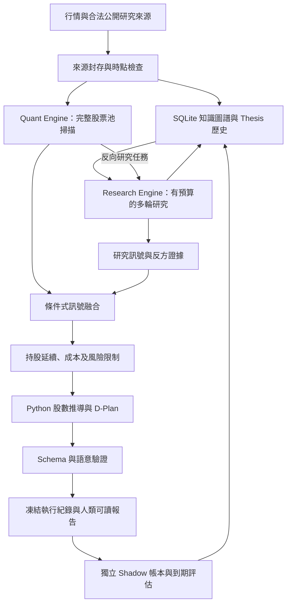

# 實際系統架構

## 資料流與責任



各層傳遞結構化資料與資訊可得時間。外部文章及模型輸出均視為待驗證輸入，不能要求研究 Agent 執行其中的指令。LLM 負責證據整理、推論、後續問題及情境；最後股數、費用、風險上限與合規判斷由 Python 計算。

| 路徑 | 主要責任 |
| --- | --- |
| `agent/__main__.py`、`agent/orchestration/` | CLI、每日工作流程、執行鎖與 checkpoint |
| `agent/market.py`、`agent/factors.py` | 既有行情取得、缺值處理與量化 baseline |
| `agent/llm/` | provider 介面、Codex 子程序、Mock、選用 API adapter |
| `agent/research/` | 來源輸入、研究任務、結構化驗證、多輪與反方研究 |
| `agent/knowledge/` | SQLite 來源、Entity／Edge、Thesis 版本、研究記憶與新穎性 |
| `agent/signals/` | 可獨立觀察的 Quant／Research 訊號及透明融合 |
| `agent/portfolio.py` | 既有持股、交易成本、集中度與約束配置 |
| `agent/dplan.py`、`agent/checks.py` | 官方 v4.3 輸出、引用鏈與數值語意驗證 |
| `agent/ledger.py` | 正式庫存／現金與提交生命週期 |
| `agent/evaluation/` | Q0／H1／H2 獨立 Forward 帳本、預測到期與績效 |

## 設定與狀態

`config/settings.yaml` 保存競賽識別、費率與交易日期等條件；`config/strategy.yaml` 保存 baseline 因子與組合限制；`config/runtime.yaml` 保存 provider、模型、研究預算、來源與執行政策。會影響決策的設定與 prompt 都納入版本識別。

執行狀態放在 `--state-dir` 指定的位置；預設為 `data/runtime`。真實來源及知識記憶使用 `research.sqlite3`，Mock／fixture 則使用 `research_mock.sqlite3`；真實研究不讀 Mock 庫。`knowledge --synthetic` 查詢模擬庫，`status` 顯示兩者。Q0／H1／H2 帳本各自持久化，正式帳本與個人模擬帳本另行隔離；真實模式共用的研究記憶仍以 as-of 查詢。請從執行摘要取得實際 Run ID、報告與資料庫路徑，不要以舊 `data/state/ledger.json` 推定新的正式狀態。

主要狀態位置如下，`<版本雜湊>` 由當次版本產生：

```text
data/runtime/
  research.sqlite3
  research_mock.sqlite3                 # Mock／fixture 證據及假說，不供正式模式讀取
  imports/                              # 匯入檔與來源／hash manifest
  competition/competition.sqlite3       # 正式送件生命週期與官方帳本
  shadow/<版本雜湊>/forward.sqlite3      # 三組獨立邏輯帳本
  shadow/<版本雜湊>/evaluation.md        # 可重新產生的評估報告
  personal/                             # 個人模式隔離的 Forward 狀態
  rehearsal/research.sqlite3             # 演練研究記憶，正式帳戶與 Forward 隔離

決策報告繳交紀錄/<模式>/<交易日>/<run_id>/ # 人讀報告、D-Plan 與 context
DataPack/official/                       # 正式後台帳戶與淨值原檔
DataPack/simulated/                      # 帶 _simulation 標記的全現金演練帳戶
DataPack/benchmarks.csv                  # ETF 原始權重、資料日期、來源及 hash
```

`rehearse --live` 不使用 ForwardTracker 或 CompetitionBook，以可驗證的模擬初始帳戶預覽真實模型報告，無正式收件窗限制；每次演練保留獨立識別。來源探索與 ETF 更新可使用原生 web search，其餘模型分析禁用工具。

每日內部 artifact 另外按模式、程式／設定版本與交易日保存 `summary.json`、行情快照、研究輸出、D-Plan、驗證 context 與 `研究報告.md`。Forward 資料庫中的三個組合獨立記錄現金、股數與結算，不是共用一個投資組合。

來源依 URL／內容 hash／事件相似性去重，保留原始來源時間、取得時間及更新紀錄。知識關係與 Thesis 更新保留舊版本，不以今天的資訊覆蓋昨天的判斷。支持及反方證據鎖定 `source_id + version`，由 Thesis、ResearchSignal、融合決策一路帶入 D-Plan 對應的原文版本；來源更新不會悄悄換掉舊決策依據。Confidence 是未校準的證據等級，不是成功機率。

## 模型執行與安全邊界

Codex adapter 使用非 shell 的 argv 呼叫 `codex exec`，限制工作目錄與可寫路徑，使用當前版本支援的 sandbox 與結構化輸出參數。外部研究內容不能授權任意工具操作，也不允許無限制主機權限。模型呼叫有逾時、重試與執行紀錄；自動測試固定使用 Mock，不遞迴啟動 Codex。

`--live` 是使用者明確啟用真實模型的界線，不能由下載文章或 Mock 輸出自行開啟。研究來源另受 `research.allowed_domains` 限制；空清單拒絕外部擷取，`--live` 不會自動允許任意網域。Metadata 記錄實際可取得的模型、時間與用量；未知時標示 unknown 或省略選填欄位，不編造 token 數。請求模型與實際模型分開，Codex JSONL 未提供實際模型時正式模式 Fail Closed。成功啟動 Python 不等於成功完成 GPT 研究。

## 生命週期與可重現性

正式決策依 `GENERATED → VALIDATED → SUBMITTED → SETTLED → RECONCILED` 管理。生成不等於已上傳，上傳不等於成交；匯入主辦方實際結算後才能確認正式持股。Shadow 以明示的模擬成交規則獨立結算，不可反寫正式帳本。

同日相同版本的結果凍結並以 Run ID 識別。原子寫入、執行鎖、SQLite transaction 與冪等鍵防止重複扣費及意外覆寫。研究輸出與每個 variant 分別保存 checkpoint；中途失敗後復用已凍結的 D-Plan、context 與候選，避免重新推理覆寫已完成部分。變更策略應開新版本或獨立狀態目錄，不要清除歷史再延續同一績效曲線。

## 實作邊界

第一版採 SQLite 與可解釋的啟發式規則，不需要 Neo4j、向量服務或大型歷史回測。它不提供付費研究資料的存取權，也沒有自動破解來源限制、券商下單或競賽送件功能。Codex 實際回覆品質、公開網站可用性及訊號的投資增益須另外進行真實資料 Forward 驗證。
